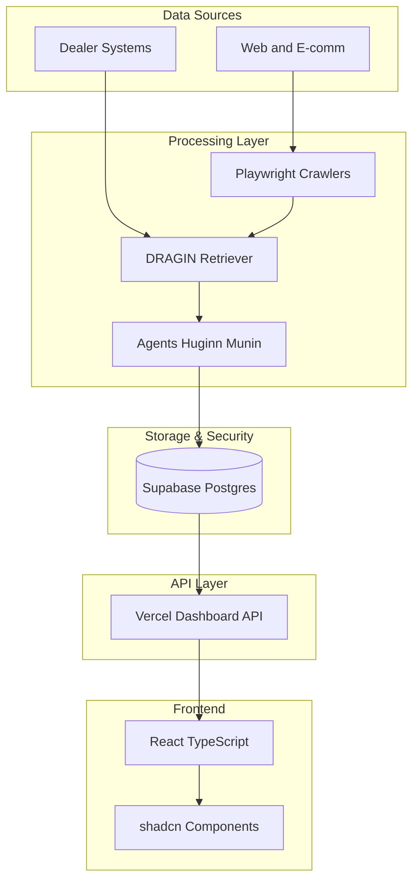

# HRAFN Dealer Intelligence Platform

HRAFN is an alpha-stage dealer intelligence and recommendation engine that ingests dealer integration data and powers recommendations, execution logs, and aggregate-safe benchmarking. The platform provides dealers with real-time insights into inventory, sales, and competitive positioning through modern React dashboards and secure Supabase backend.

## Philosophy: AI-Native by Design

- Utilizes autonomous agents (Huginn, Munin) to continuously gather and process dealer data.
- Employs DRAGIN as a large language model gateway for retrieval, indexing, and normalization of data.
- Integrates evaluation and guardrails to ensure data quality and reliable recommendations.
- Supports aggregate-safe analytics to protect dealer privacy while enabling benchmarking insights.

## Architecture Overview

**Legend:**
- **Dealer Systems**: DMS, CRM, Inventory, Scheduler
- **Web and E-comm**: Dealer websites, e-commerce platforms
- **DRAGIN Retriever**: Distributed RAG over integrations - retrieval, indexing, normalization
- **Agents Huginn Munin**: Huginn (monitoring/alerts), Munin (recommendations/actions)
- **Playwright Crawlers**: Automated web scraping for competitive intelligence
- **Supabase Postgres**: PostgreSQL with RLS, Auth, Object Storage
- **Vercel Dashboard API**: Next.js API routes for dealer dashboard
- **React TypeScript**: Frontend application
- **shadcn Components**: UI component library

### Core Components
- **Frontend**: Vite + React 18 + TypeScript with shadcn/ui components
- **Backend**: Supabase (Postgres, Edge Functions, Auth, Object Storage)
- **Intelligence Layer**: DRAGIN (retrieval/index/normalization) + Huginn/Munin agents
- **Security**: Row Level Security (RLS) for dealer isolation, aggregate-safe analytics
- **APIs**: Dealer integration adapters, competitive crawlers

## 📁 Repository Structure
- `/docs`: Documentation and design specs

## 📚 Documentation
For a full table of contents and detailed guides, please refer to the [docs/README.md](docs/README.md).

## About
HRAFN is an alpha-stage platform for dealer intelligence and recommendations, emphasizing recommendation logs, dealer isolation, and aggregate-safe analytics. The platform uses secure multi-tenant architecture with RLS enforcement and comprehensive data pipelines for automated competitive analysis.
