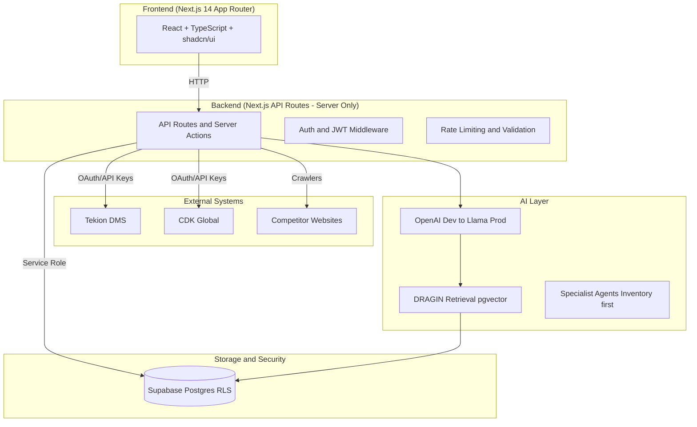

# HRAFN Dealer Intelligence Platform

HRAFN is an alpha-stage dealer intelligence and recommendation engine that ingests dealer integration data and powers recommendations, execution logs, and aggregate-safe benchmarking. The platform provides dealers with real-time insights into inventory, sales, and competitive positioning through modern React dashboards and secure Supabase backend.

## Philosophy: AI-Native by Design

- Utilizes autonomous agents (Huginn, Munin) to continuously gather and process dealer data.
- Employs DRAGIN as a large language model gateway for retrieval, indexing, and normalization of data.
- Integrates evaluation and guardrails to ensure data quality and reliable recommendations.
- Supports aggregate-safe analytics to protect dealer privacy while enabling benchmarking insights.

## Architecture Overview

**Legend:**
- **Next.js API Routes**: Single server surface; all secrets server-side
- **DRAGIN Retrieval**: Distributed RAG across SQL + vectors (pgvector)
- **Specialist Agents**: Inventory-first for demo; others follow
- **Supabase Postgres**: RLS-enforced multi-tenant database
- **OpenAI → Llama**: Dev-time OpenAI, production migration to Llama

### Core Components
- **Full-Stack Framework**: Next.js 14 (App Router) — React 18 + TypeScript + shadcn/ui
- **Backend Layer**: Next.js API Routes for all secure operations (no client DB access)
- **Database**: Supabase Postgres with RLS; accessed via server-only service role
- **Intelligence**: DRAGIN retrieval (pgvector) + specialist agents (Inventory-first)
- **Integrations**: Tekion/CDK adapters and optional Playwright-based competitive crawlers
- **APIs**: Single surface area at Next.js API routes (rate limited, validated)

### Security Essentials
- Credentials and service role keys are server-side only; never in the browser
- All DB reads/writes go through Next.js API routes; RLS enforced
- JWT includes `dealer_id` claim; middleware verifies and scopes requests
- Basic rate limiting and input validation on API routes

## 📁 Repository Structure
- `/docs`: Documentation and design specs

## 📚 Documentation
For a full table of contents and detailed guides, please refer to the [docs/README.md](docs/README.md).

### Planning and Timeline
- Development Plan: [docs/Legacy_Planning/development_plan.md](docs/Legacy_Planning/development_plan.md)
- Client Presentation Guide: [docs/Legacy_Planning/presentation_guide.md](docs/Legacy_Planning/presentation_guide.md)

## About
HRAFN is an alpha-stage platform for dealer intelligence and recommendations, emphasizing recommendation logs, dealer isolation, and aggregate-safe analytics. The platform uses secure multi-tenant architecture with RLS enforcement and comprehensive data pipelines for automated competitive analysis.
