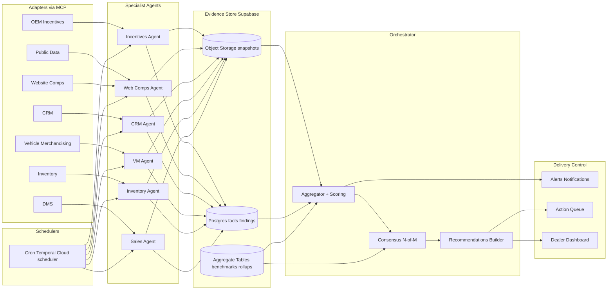

# HRAFN Agentic Passive Architecture (V1.0)

**See also:** [Agentic Passive Benchmarks](./agentic_passive_benchmarks.md) | [Architecture Overview](./architecture_overview.md) | [Discount Flow](./discount_flow.md) | [Data Model](./data_model.md)

See [agentic_passive_benchmarks.md](./agentic_passive_benchmarks.md) for the V1.1 version with benchmarking capabilities.

**Legend:**

- **Cron Temporal Cloud scheduler**: Scheduled job orchestration (Cron, Temporal, or cloud scheduler)
- **Website Comps**: Website and competitor analysis
- **Web Comps Agent**: Agent for web scraping and competitive intelligence
- **Evidence Store Supabase**: Supabase-based evidence storage
- **Postgres facts findings**: PostgreSQL database storing facts and findings
- **Aggregate Tables benchmarks rollups**: Aggregate tables for benchmarks and rollups
- **Object Storage snapshots**: Object storage for historical snapshots
- **Aggregator + Scoring**: Evidence aggregation and scoring engine
- **Consensus N-of-M**: N-of-M consensus mechanism for agent decisions
- **Alerts Notifications**: Alert and notification system
- **Action Queue**: Queue for pending actions

## Change Log

- v0.1: Initial draft defining core agentic architecture with specialist agents and orchestration flow
