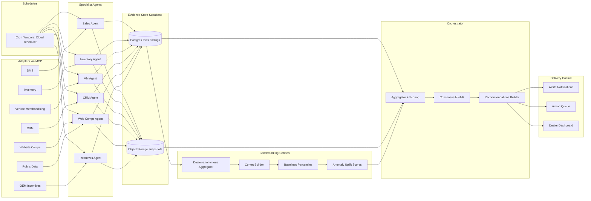

# HRAFN Agentic Passive Architecture with Benchmarking (V1.1)

**See also:** [Agentic Passive](./agentic_passive.md) | [Aggregates & Benchmarks](./aggregates_benchmarks_spec.md) | [Architecture Overview](./architecture_overview.md) | [Metrics Catalog](./metrics_catalog.md)

See [agentic_passive.md](./agentic_passive.md) for the V1 core version without benchmarking.



**Legend:**
- **Cron Temporal Cloud scheduler**: Scheduled job orchestration (Cron, Temporal, or cloud scheduler)
- **Website Comps**: Website and competitor analysis
- **Web Comps Agent**: Agent for web scraping and competitive intelligence
- **Evidence Store Supabase**: Supabase-based evidence storage
- **Postgres facts findings**: PostgreSQL database storing facts and findings
- **Object Storage snapshots**: Object storage for historical snapshots
- **Benchmarking Cohorts**: Benchmarking and cohort analysis subsystem
- **Baselines Percentiles**: Baseline metrics and percentile calculations
- **Anomaly Uplift Scores**: Anomaly detection and uplift scoring
- **Aggregator + Scoring**: Evidence aggregation and scoring engine
- **Consensus N-of-M**: N-of-M consensus mechanism for agent decisions
- **Alerts Notifications**: Alert and notification system
- **Action Queue**: Queue for pending actions

---

## Baseline Math

### Cohorting
- `cohort_id` := hash(concat(region, segment, drivetrain, price_band, model_year_band)).
- Required keys: `region`, `segment`. Optional keys used when coverage ≥ 65%.
- Cohorts regenerate nightly; IDs are stable unless keys change.

### Windows & Aggregation
- Default baseline window: last 90 days rolling; report window configurable (e.g., last 7/30 days).
- Aggregation grain: `day` for time series, `month` for inventory turns.
- Metrics per `cohort_id, day` from aggregate tables (`aggregate_inventory_metrics`, `aggregate_offer_performance`).

### Outlier Handling
- Winsorize each metric at [p1, p99] within cohort-day before computing baselines.
- Minimum distinct dealer contributors per cell: **N ≥ 5** (strict). Cells failing this are suppressed (see Suppression Rules).

### Percentiles & Central Tendency
For each `(cohort_id, day, metric)`:
- Compute `p10, p25, p50, p75, p90` using t-digest or P² algorithm for streaming accuracy.
- Compute `mean` and `stddev` with Welford’s algorithm.

### Seasonality & Smoothing
- 7‑day moving average for daily series; 4‑week moving average for weekly series.
- Optional STL decomposition for seasonal adjustment on long horizons (> 180 days).

### Scores
- **Z‑score:** `z = (value - mean) / stddev` (guard: if `stddev < 1e-6`, set `z = 0`).
- **Uplift vs Median:** `uplift_pct = (value - p50) / NULLIF(p50,0)`.
- **Anomaly Score:** `anomaly = sigmoid(|z|) * coverage_weight`, where `coverage_weight = min(1, N/20)`.

Outputs populate `benchmarks_baselines` (percentiles) and `benchmarks_scores` (value, zscore, anomaly_score).

---

## Suppression & Privacy Rules

### K‑Anonymity
- Suppress any cell with contributor count **N < 5**.
- Secondary suppression: if only one cell in a group is suppressed and the remainder enables inference, suppress the next smallest cell to maintain k‑anonymity.

### Dominance Rule
- If the largest contributor accounts for > 60% of the cell’s total weight, suppress the cell.

### Noise (Optional DP)
- For public or OEM‑wide exports, add Laplace noise with `ε = 8` at the cohort‑day level to `p50` and means. Internal dealer dashboards use raw aggregates with suppression only.

### Role Enforcement
- Aggregates are **SELECT‑only** behind the `analytics` role. No dealer identifiers present.

Suppressed cells return `null` values plus `suppressed=true` and `reason` in the payload.

---

## Data Quality Gates
- Reject cohort‑day if coverage (dealers reporting) < 50% of the expected cohort members for that day.
- Flag and exclude any source where metric jumps > 5σ day‑over‑day before baseline computation.

---

## Example Pseudocode

```sql
-- Percentiles into benchmarks_baselines
INSERT INTO benchmarks_baselines(day, cohort_id, metric, p10, p25, p50, p75, p90)
SELECT day, cohort_id, metric,
       approx_percentile(value, 0.10) AS p10,
       approx_percentile(value, 0.25) AS p25,
       approx_percentile(value, 0.50) AS p50,
       approx_percentile(value, 0.75) AS p75,
       approx_percentile(value, 0.90) AS p90
FROM cohort_metric_values -- derived from aggregate tables
WHERE contributors >= 5 AND dominance_pct <= 0.60
GROUP BY day, cohort_id, metric;

-- Scores into benchmarks_scores
INSERT INTO benchmarks_scores(day, cohort_id, metric, value, zscore, anomaly_score)
SELECT v.day, v.cohort_id, v.metric, v.value,
       CASE WHEN b.stddev < 1e-6 THEN 0 ELSE (v.value - b.mean)/b.stddev END AS z,
       1/(1+exp(-abs(CASE WHEN b.stddev < 1e-6 THEN 0 ELSE (v.value - b.mean)/b.stddev END))) * LEAST(1, v.contributors/20.0) AS anomaly
FROM cohort_metric_values v
JOIN cohort_metric_stats b USING(day, cohort_id, metric)
WHERE v.contributors >= 5 AND v.dominance_pct <= 0.60;
```

## Change Log
- v0.1: Initial draft defining agentic architecture with benchmarking, baseline math, and suppression rules

---
