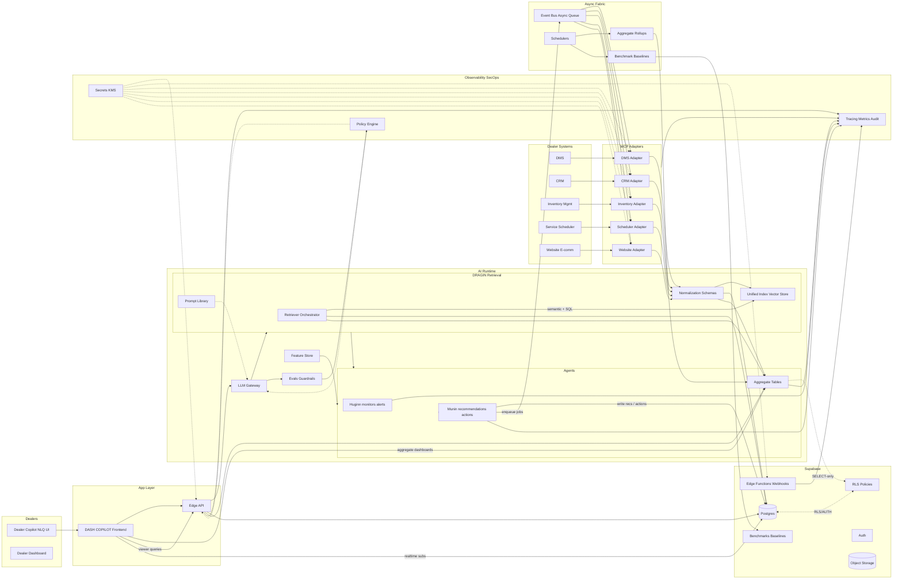

# HRAFN Architecture Overview

**See also:** [Data Model](./data_model.md) | [Security RLS](./security_rls.md) | [Agentic Passive Benchmarks](./agentic_passive_benchmarks.md) | [NLQ Planner](./nlq_planner_spec.md)

This document provides comprehensive architecture diagrams for the HRAFN AI-native dealer intelligence platform.

## High-Level System Architecture

```mermaid
flowchart LR
  %% ===== LAYERS =====
  subgraph Dealer_Systems["Dealer Systems"]
    DMS[CDK Reynolds Tekion]
    CRM[CRM]
    INV[Inventory Mgmt]
    SCHED[Service Scheduler]
    WEB[Website E-comm]
    OEM[OEM Incentives Feeds]
  end

  subgraph MCP["MCP Adapters"]
    A1[DMS Adapter]
    A2[CRM Adapter]
    A3[Inventory Adapter]
    A4[Scheduler Adapter]
    A5[Website Adapter]
    A6[OEM Feed Adapter]
  end

  subgraph DRAGIN["DRAGIN Layer"]
    RQ[Retriever Orchestrator]
    IDX[Unified Index Vector Store]
    PIP[Normalization Schemas]
  end

  subgraph HRAFN_Core["HRAFN Core"]
    subgraph Agents["Agents"]
      HUG[Huginn monitor alerts]
      MUN[Munin recommendations actions]
    end
    Q[Async Queue]
    OBS[Observability & Audit]
  end

  subgraph Supabase["Supabase"]
    PG[(Postgres)]
    RLS[RLS Policies]
    EDGE[Edge Functions Webhooks]
    AUTH[Auth Policies]
    STG[(Object Storage)]
    AGG[Aggregate Tables]
    BENCH[Benchmarks Baselines]
  end

  subgraph Vercel["Vercel"]
    UI[Dealer Dashboard]
    API[API Routes]
  end

  subgraph SecOps["Security Secrets"]
    VAULT[Secrets env kv]
  end

  %% ===== DATA FLOWS =====
  DMS -->|events/data| A1
  CRM --> A2
  INV --> A3
  SCHED --> A4
  WEB --> A5
  OEM --> A6

  A1 -->|normalized via| PIP
  A2 -->|normalized via| PIP
  A3 -->|normalized via| PIP
  A4 -->|normalized via| PIP
  A5 -->|normalized via| PIP
  A6 -->|normalized via| PIP
  PIP --> IDX
  PIP --> PG
  PIP --> AGG

  %% Retrieval
  RQ -->|semantic + SQL| IDX
  RQ --> PG
  RQ --> AGG

  %% Agents consume retrieved context
  RQ --> HUG
  RQ --> MUN

  %% Actions and writes
  MUN -->|write recs / actions| PG
  MUN -->|enqueue jobs| Q
  Q -->|call back through adapters| A1
  Q --> A2
  Q --> A3
  Q --> A4
  Q --> A5

  %% Supabase <-> App
  PG <-.RLS/AUTH.-> RLS
  UI -->|viewer queries| API
  UI -->|aggregate dashboards| AGG
  API -->|Supabase client| PG
  EDGE --> PG
  EDGE --> A1
  EDGE --> A2
  EDGE --> A3
  UI -->|realtime subs| PG

  %% Observability and audit
  HUG --> OBS
  MUN --> OBS
  MCP --> OBS
  EDGE --> OBS
  AGG --> OBS

  %% Secrets
  VAULT -.-> A1
  VAULT -.-> A2
  VAULT -.-> API
  VAULT -.-> EDGE

  %% Schedulers / ETL
  subgraph Schedulers["Schedulers ETL"]
    CRON[Cron Temporal]
    ETL[Aggregate Rollups]
    BASE[Benchmark Baselines]
  end

  CRON --> ETL
  ETL --> AGG
  CRON --> BASE
  BASE --> BENCH

  %% OEM actions rarely direct
  MUN -.optional OEM msg.-> A6
```

**Legend:**
- **Dealer Systems**: CDK, Reynolds, Tekion (DMS providers)
- **Website E-comm**: Dealer websites and e-commerce platforms
- **OEM Incentives Feeds**: OEM incentive data feeds
- **MCP Adapters**: Universal plug adapters for dealer systems
- **DRAGIN Layer**: Distributed RAG over integrations
- **Retriever Orchestrator**: Query orchestration and routing
- **Unified Index Vector Store**: Semantic search and vector storage
- **Normalization Schemas**: Data standardization layer
- **Huginn monitor alerts**: Monitoring and alerting agent
- **Munin recommendations actions**: Recommendation and action execution agent
- **Supabase**: Single source of truth - Postgres, RLS, Edge Functions, Auth, Object Storage
- **Benchmarks Baselines**: Aggregate benchmark data
- **Security Secrets**: Environment variables and key vault
- **Schedulers ETL**: Cron/Temporal schedulers for ETL jobs

## AI-Native Runtime Architecture

Goal: AI‑first system for dealer intelligence, recommendations, and execution. Privacy by default, aggregate‑safe analytics, and agentic actions.

**Legend:**
- **Dealer Copilot NLQ UI**: Natural language query interface for dealers
- **Website E-comm**: Dealer websites and e-commerce platforms
- **MCP Adapters**: Model Context Protocol adapters for system integration
- **DRAGIN Retrieval**: Distributed RAG - retrieval, indexing, normalization
- **Unified Index Vector Store**: Semantic search and vector embeddings
- **Huginn monitors alerts**: Monitoring and alerting agent
- **Munin recommendations actions**: Recommendation and action execution agent
- **LLM Gateway**: Provider routing, caching, guardrails for LLM calls
- **Evals Guardrails**: Off-policy tests, toxicity detection, PII scrubbing
- **Feature Store**: Online features stored in PostgreSQL
- **Edge Functions Webhooks**: Supabase Edge Functions and webhook handlers
- **DASH COPILOT Frontend**: Combined dashboard and copilot interface
- **Tracing Metrics Audit**: Observability and audit logging
- **Secrets KMS**: Key management system for secrets
- **Policy Engine**: PII scrubbing and rate limiting policies
- **Event Bus Async Queue**: Asynchronous job queue

**Access Paths:** Dealer-scoped queries hit Postgres under RLS. Cross-dealer questions and benchmarking read from Aggregate Tables and Benchmarks via SELECT-only roles. Schedulers drive nightly rollups and baseline refreshes.

## Change Log
- v0.1: Initial draft with comprehensive architecture diagrams for AI-native platform