# HRAFN Data Model: Dealer Intelligence & Recommendation Platform

**See also:** [Security RLS](./security_rls.md) | [Aggregates & Benchmarks](./aggregates_benchmarks_spec.md) | [Stored Procedures](./stored_procs_catalog.md) | [Architecture Overview](./architecture_overview.md)

This document is the authoritative schema reference. It must stay consistent with `security_rls.md`, `aggregates_benchmarks_spec.md`, and `stored_procs_catalog.md`.

This document outlines the updated HRAFN database schema designed to support secure dealer-level data isolation, aggregate benchmarking, and high-performance queries for dealer intelligence, recommendation, and execution workflows.

---

## 1. Dealer-Level Secure Isolation

The core of the platform is built around strict **row-level security (RLS)** to ensure each dealer's data is securely isolated. All dealer-scoped tables include a `dealer_id` foreign key and enforce RLS policies that restrict access to data only for the authenticated dealer.

### Key Principles:

- **Dealer Integration Data** replaces previous CDK-specific terminology to accommodate diverse dealer data sources.
- All transactional and operational data is scoped by `dealer_id`.
- RLS policies use JWT claims to enforce strict data visibility.
- Minimal exposure of sensitive data; no cross-dealer joins on dealer-scoped tables.
- Execution logs and recommendation actions are tied to dealer context for auditability.

---

## 2. Aggregate & Benchmark Data for Cross-Dealer Analysis

To enable market benchmarking, competitive intelligence, and aggregate analytics, the platform maintains **aggregate intelligence tables** that strip out `dealer_id` and combine data across dealers.

All aggregate tables must enforce k-anonymity (suppress cells with N<5) and are SELECT-only for analytics roles.

### Features:

- Aggregated tables support cross-dealer comparisons without compromising individual dealer privacy.
- Benchmark metrics such as pricing trends, inventory velocity, and incentive effectiveness.
- Designed for high-performance analytical queries.
- Data refreshes via ETL processes that sanitize and aggregate dealer-scoped data.

---

## 3. Entity Relationship Diagram

Diagram shows both dealer-scoped and aggregate domains. Benchmark tables and snapshot tables are defined in `aggregates_benchmarks_spec.md` and not repeated here.

```mermaid
erDiagram
    %% Dealer-Scoped Domain
    dealers ||--o{ dealer_sites : "has multiple sites"
    dealers ||--o{ inventory_listings : "owns inventory"
    dealers ||--o{ offers : "creates offers"
    dealers ||--o{ sales_leads : "manages leads"
    dealers ||--o{ sales_activity_history : "tracks activities"
    dealers ||--o{ recommendation_logs : "logs recommendation executions"

    %% Aggregate Intelligence Domain
    aggregate_inventory_metrics {
        text model_family PK
        date day PK
        text region PK
        text cohort_id
        decimal avg_price
        decimal median_price
        decimal avg_days_on_lot
        integer total_listings
        timestamptz updated_at
    }

    aggregate_offer_performance {
        text offer_type PK
        text model_family PK
        date day PK
        text region PK
        text cohort_id
        decimal avg_apr
        decimal avg_cashback
        integer total_offers
        timestamptz updated_at
    }

    %% Dealer-Scoped Tables
    dealers {
        uuid id PK
        text name
        text region
        timestamptz created_at
        timestamptz updated_at
    }

    dealer_sites {
        uuid id PK
        uuid dealer_id FK
        text site_url
        text inventory_url
        boolean robots_allowed
        timestamptz last_crawl_ok
        timestamptz created_at
        timestamptz updated_at
    }

    inventory_listings {
        uuid id PK
        uuid dealer_id FK
        text vin UK
        integer year
        text make
        text model
        text trim
        text body_style
        text drivetrain
        decimal msrp
        decimal price
        integer mileage
        text status
        timestamptz scraped_at
        timestamptz created_at
        timestamptz updated_at
    }

    offers {
        uuid id PK
        uuid dealer_id FK
        text offer_type
        text model_family
        text trim
        decimal apr
        decimal cashback
        integer term_months
        decimal due_at_signing
        integer miles_per_year
        date expiry
        text fine_print_text
        text source_url
        jsonb comparability_flags
        boolean is_conditional
        uuid image_asset_id
        timestamptz created_at
        timestamptz updated_at
    }

    sales_leads {
        uuid id PK
        uuid dealer_id FK
        text lead_source
        text status
        timestamptz created_at
        timestamptz updated_at
    }

    sales_activity_history {
        uuid id PK
        uuid dealer_id FK
        uuid sales_lead_id FK
        text activity_type
        text notes
        timestamptz activity_timestamp
        timestamptz created_at
        timestamptz updated_at
    }

    recommendation_logs {
        uuid id PK
        uuid dealer_id FK
        text recommendation_type
        jsonb parameters
        text execution_status
        timestamptz executed_at
        timestamptz created_at
        timestamptz updated_at
    }

    %% Snapshot Tables (append-only, partitioned by day)
    inventory_listings_snapshots {
        uuid id PK
        uuid dealer_id FK
        date day PK
        text vin
        jsonb payload
        timestamptz created_at
    }

    offers_snapshots {
        uuid id PK
        uuid dealer_id FK
        date day PK
        jsonb payload
        timestamptz created_at
    }

    sales_leads_snapshots {
        uuid id PK
        uuid dealer_id FK
        date day PK
        jsonb payload
        timestamptz created_at
    }

    sales_activity_history_snapshots {
        uuid id PK
        uuid dealer_id FK
        date day PK
        jsonb payload
        timestamptz created_at
    }

    recommendation_logs_snapshots {
        uuid id PK
        uuid dealer_id FK
        date day PK
        jsonb payload
        timestamptz created_at
    }
```



---

## 4. Design Notes

- **Dealer Integration Data**: Flexible ingestion from multiple dealer systems, normalized into unified dealer-scoped tables.
- **Row-Level Security**: All dealer data enforces RLS based on `dealer_id` claim in JWT tokens, ensuring strict data isolation.
- **Recommendation & Execution**: Agents generate personalized recommendations per dealer; execution logs track actions and outcomes for auditing and feedback loops.
- **Aggregate Intelligence**: Periodic ETL jobs aggregate dealer data into sanitized tables for benchmarking and market insights.
- **Minimal Exposure**: Aggregate tables omit any dealer-specific identifiers, preventing re-identification.
- **Extensibility**: Schema supports future integration of AI-driven recommendation models and dealer feedback mechanisms.
- **Benchmarking & History**: Daily snapshots and baselines are materialized into aggregate tables, ensuring stable comparisons over time.

---

## 5. Indexing Strategy & Performance Considerations

### Dealer-Scoped Tables

- **Index on `dealer_id`** for all dealer-scoped tables to optimize RLS-filtered queries.
- **Unique constraints** on `(dealer_id, vin)` in `inventory_listings` to prevent duplicates.
- **Covering indexes** on frequently queried columns such as `model_family`, `offer_type`, and `expiry` in `offers`.
- **Timestamps indexing** for efficient incremental data retrieval and synchronization.

### Aggregate Tables

- **Composite primary keys** on `(model_family, day)` or `(offer_type, model_family, day)` for partitioning and fast lookups.
- **Indexes on date columns** to support time-series analytics.
- **Materialized views** or summary tables to pre-aggregate data for dashboard performance.
- Indexes on region and cohort_id to support cohort and geography filters.
- Consider partial indexes per region for hot markets.

### Benchmark & Snapshot Tables

- Partition by `day` for fast time-series queries.
- Index on `cohort_id` or `region` where applicable.
- Refresh materialized views nightly or more frequently if SLA requires.
- Use BRIN indexes on `day` for large partitions.

---

## 6. Security & Data Governance

- **RLS Policies**: Enforced on all dealer-scoped tables using `dealer_id` JWT claims.
- **Audit Logging**: Recommendation executions and key data changes logged for traceability.
- **Data Minimization**: Aggregate tables strip dealer identifiers to ensure privacy.
- **Access Controls**: Role-based access controls complement RLS for admin and analytics roles.
- **Stored Procedures & Templates**: All cross-dealer analytics must run through parameterized stored procedures; no ad-hoc SQL is permitted by agents.

---

## 7. Sample RLS Policy (PostgreSQL)

```sql
CREATE POLICY dealer_isolation_policy ON inventory_listings
FOR ALL USING (dealer_id = current_setting('app.jwt.claims.dealer_id')::uuid);
```

Additional RLS policies for other dealer-scoped tables follow the same pattern. Full definitions are in `security_rls.md`.

---

## 8. Sample Index Definitions

```sql
-- Dealer-scoped indexes
CREATE INDEX idx_inventory_listings_dealer_id ON inventory_listings(dealer_id);
CREATE UNIQUE INDEX ux_inventory_listings_dealer_vin ON inventory_listings(dealer_id, vin);

CREATE INDEX idx_offers_dealer_model_expiry ON offers(dealer_id, model_family, expiry);

-- Aggregate indexes
CREATE UNIQUE INDEX ux_aggregate_inventory_metrics_model_day ON aggregate_inventory_metrics(model_family, day);
CREATE UNIQUE INDEX ux_aggregate_offer_performance_type_model_day ON aggregate_offer_performance(offer_type, model_family, day);

-- Region/cohort indexes for aggregates
CREATE INDEX idx_agg_inventory_region_day ON aggregate_inventory_metrics(region, day);
CREATE INDEX idx_agg_inventory_cohort_day ON aggregate_inventory_metrics(cohort_id, day);
CREATE INDEX idx_agg_offer_region_day ON aggregate_offer_performance(region, day);
CREATE INDEX idx_agg_offer_cohort_day ON aggregate_offer_performance(cohort_id, day);

-- Snapshot tables indexing
CREATE INDEX idx_inventory_snapshots_dealer_day ON inventory_listings_snapshots(dealer_id, day);
CREATE INDEX idx_offers_snapshots_dealer_day ON offers_snapshots(dealer_id, day);
CREATE INDEX idx_sales_leads_snapshots_dealer_day ON sales_leads_snapshots(dealer_id, day);
CREATE INDEX idx_sales_activity_snapshots_dealer_day ON sales_activity_history_snapshots(dealer_id, day);
CREATE INDEX idx_reco_logs_snapshots_dealer_day ON recommendation_logs_snapshots(dealer_id, day);
```

---

This updated data model supports HRAFN's pivot towards dealer intelligence, enabling secure, scalable, and performant dealer data management alongside robust aggregate analytics for market benchmarking and recommendation execution.

## Change Log

- v0.1: Initial draft with comprehensive dealer-scoped and aggregate table definitions, RLS policies, and indexing strategy
