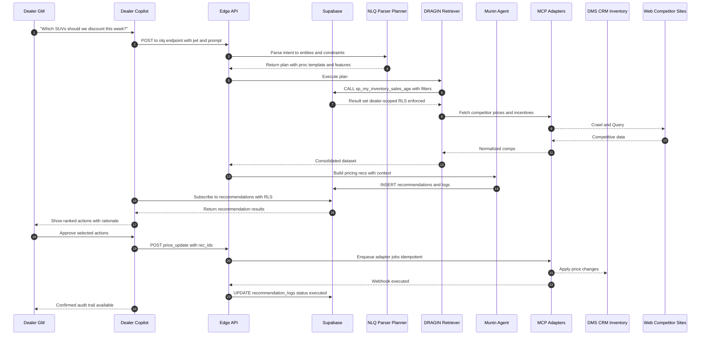

# HRAFN Discount Flow: NLQ Co-Pilot Example

**See also:** [NLQ Planner](./nlq_planner_spec.md) | [Architecture Overview](./architecture_overview.md) | [Agentic Passive](./agentic_passive.md) | [Data Model](./data_model.md)

This document illustrates an end-to-end natural language query flow for dealer pricing recommendations.

**Legend:**

- **Dealer GM**: Dealer General Manager (user)
- **Dealer Copilot**: Natural language query interface (NLQ UI)
- **Edge API**: Supabase Edge Function API
- **Supabase**: Postgres database with RLS
- **NLQ Parser Planner**: Natural language query parser and planner
- **DRAGIN Retriever**: Distributed RAG retrieval orchestrator
- **Munin Agent**: Recommendation and action agent (recs)
- **MCP Adapters**: Model Context Protocol adapters
- **DMS CRM Inventory**: Dealer Management System, CRM, and Inventory systems
- **Web Competitor Sites**: Web scraping for competitor analysis

## Change Log

- v0.1: Initial draft defining end-to-end NLQ co-pilot flow for pricing recommendations
