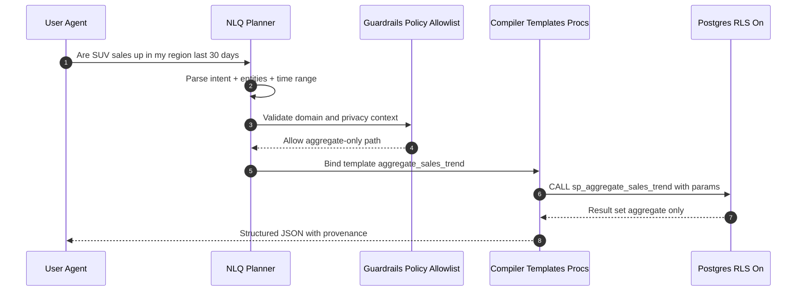

# HRAFN NLQ Planner Specification

**See also:** [Security RLS](./security_rls.md) | [Data Model](./data_model.md) | [Aggregates & Benchmarks](./aggregates_benchmarks_spec.md) | [Stored Procedures](./stored_procs_catalog.md) | [Metrics Catalog](./metrics_catalog.md)

This document defines the natural-language-to-query (NLQ) planning layer used by the dealer app and agents. The planner compiles user intent into **parameterized stored procedure calls** and **allow‑listed SQL templates** that execute under Postgres RLS.

> This spec must remain consistent with: `docs/security_rls.md`, `docs/data_model.md`, `docs/aggregates_benchmarks_spec.md`, `docs/stored_procs_catalog.md`, and `docs/metrics_catalog.md`.

---

## 1) Purpose and Scope

- Convert dealer/operator questions into safe, auditable data queries.
- Enforce privacy: never bypass RLS; cross‑dealer questions must hit aggregate/benchmark tables only.
- Produce stable queries for parity over time and reproducible analytics.

Out of scope: free‑form SQL generation, schema migration logic, dashboard rendering.

---

## 2) High‑Level Flow



**Legend:**

- **User Agent**: User or automated agent making the query
- **NLQ Planner**: Natural language query planning engine
- **Guardrails Policy Allowlist**: Policy enforcement and query allowlist validation
- **Compiler Templates Procs**: Template compiler and stored procedure selector
- **Postgres RLS On**: PostgreSQL database with Row Level Security enabled

---

## 3) Inputs and Outputs

**Input JSON**

```json
{
  "utterance": "text",
  "actor": {
    "role": "dealer_user|oem_user|system_agent",
    "dealer_id": "uuid|null",
    "region": "string|null"
  },
  "context": { "now": "ISO8601", "timezone": "America/New_York", "locale": "en-US" },
  "constraints": { "privacy": "strict", "max_latency_ms": 1500 }
}
```

**Output JSON**

```json
{
  "plan_id": "ulid",
  "compiled_call": {"type":"proc|template","name":"sp_...|tpl_...","version":"vX.Y.Z","params":{...}},
  "exec_role": "authenticated|analytics",
  "provenance": {"metric_defs":["sales_volume"],"tables":["benchmarks_baselines"],"docs":["metrics_catalog.md"]},
  "explain": "brief rationale",
  "fallback_used": false
}
```

---

## 4) Planner Stages

1. **Intent Parse**: classify task (trend, compare, rank, lookup, explain).
2. **Entity Resolve**: resolve time window, region, cohort, vehicle filters; map synonyms to canonical terms (see `metrics_catalog.md` for metric names).
3. **Privacy Gate**:
   - If request involves other dealers → route to aggregate domain.
   - If actor lacks `dealer_id` → block dealer‑scoped facts.
4. **Template Selection**: choose from allow‑listed catalog:
   - Aggregates: `tpl_sales_trend`, `tpl_inventory_turns`, `tpl_offer_lift`, …
   - Dealer facts (self only): `tpl_my_sales_by_model`, `tpl_my_gross_by_day`, …
5. **Compilation**: bind validated params, cast types, clamp time ranges.
6. **Execution Strategy**: prefer stored procedures; otherwise parameterized SQL template. Never emit dynamic SQL.
7. **Post‑Processing**: compute deltas, rate‑of‑change, smoothing; attach units and caveats.
8. **Provenance**: include metric definitions, template/proc version, and source tables.

---

## 5) SQL Template & Proc Catalog (excerpt)

> Full list lives in `docs/stored_procs_catalog.md`. Below shows required signatures.

- `sp_aggregate_sales_trend(region text, segment text, start date, end date) RETURNS TABLE(day date, sales int)`
- `sp_benchmark_percentiles(cohort_id text, metric text, start date, end date) RETURNS TABLE(day date, p10 numeric, p50 numeric, p90 numeric)`
- `sp_my_sales_by_model(dealer uuid, start date, end date) RETURNS TABLE(model text, sales int)`

**Template Grammar**

```
-- tpl_sales_trend_v1
SELECT day, SUM(sales_volume) AS sales
FROM aggregate_inventory_metrics
WHERE region = $1 AND vehicle_segment = $2 AND day BETWEEN $3 AND $4
GROUP BY day
ORDER BY day;
```

Rules: positional parameters only; no string concatenation; reference only tables in the allowlist.

---

## 6) Security & Guardrails

- Execute with **least‑privilege roles** (`authenticated` for dealer facts, `analytics` for aggregates).
- Enforce **RLS** at the DB; agents never receive elevated tokens.
- **No cross‑dealer joins** on dealer‑scoped tables.
- **K‑anonymity** enforced in aggregates; suppress N&lt;5.
- Rate‑limit heavy queries; reject Cartesian risks.
- Blocklist: `DROP`, `ALTER`, `COPY TO/FROM`, CTEs with `INSERT/UPDATE/DELETE`.

---

## 7) Error Handling & Fallbacks

- **Ambiguous intent** → ask for one clarifying field or fallback to a safe default window (last 30 days).
- **No data after privacy clamp** → return explanation and a suggested aggregate query.
- **Timeout** → degrade to cached materialized view where available.
- **Version mismatch** → pin to last compatible template version and emit warning in provenance.

---

## 8) Caching & Determinism

- Cache compiled plans for identical `(actor, intent, params)` keys for 15 minutes.
- Prefer materialized views when available (`etl_schedule.md`).
- Include `plan_id` and `template_version` so repeat runs are identical.

---

## 9) Testing

- **Unit**: intent classification, entity resolution, parameter binding.
- **Policy**: simulate JWTs; assert RLS blocks cross‑dealer access.
- **Golden Queries**: snapshot expected SQL and result shapes per template version.
- **Load**: ensure p95 &lt; 1.5s for standard windows.
- **Security**: fuzz inputs to verify no template injection.

Acceptance criteria:

- 100% of planner outputs are parameterized.
- 0 incidents of cross‑dealer leakage in test suite.
- Provenance includes metric doc links for all outputs.

---

## 10) Telemetry

- Log `plan_id`, actor role, template/proc, version, latency, and row counts.
- Emit counters for privacy re‑routes and k‑anonymity suppressions.
- Alert on unusual query fan‑out or sustained cache misses.

---

## 11) Examples

**A. Dealer‑only question**

- Utterance: "Show my F‑150 sales by model last week."
- Route: dealer facts → `sp_my_sales_by_model(dealer_id, start, end)`

**B. Cross‑dealer trend**

- Utterance: "Are SUV sales up in my region?"
- Route: aggregate → `sp_aggregate_sales_trend(region, 'SUV', start, end)`

**C. Benchmark position**

- Utterance: "Where am I vs peers on days‑on‑lot?"
- Route: benchmarks → `sp_benchmark_percentiles(cohort_id, 'avg_days_on_lot', start, end)`

---

## 12) Change Log

- v0.1: Initial draft. Defines planner flow, guardrails, templates, and testing requirements.
