# HRAFN Development Plan: Client Presentation Guide

**Purpose:** Diagrams, visualizations, and talking points for client presentation

**Based on:** [Development Plan](./development_plan.md)

---

## Slide 1: Project Overview

### Title: HRAFN Dealer Intelligence Platform - 3-Month Development Plan

**Key Points:**
- AI-native dealer intelligence platform
- 3-month timeline (12 weeks) for demo-ready system
- Secure, scalable architecture with Next.js full-stack framework
- MVP-first approach to deliver value quickly

---

## Slide 2: Architecture Overview

### Architecture Diagram

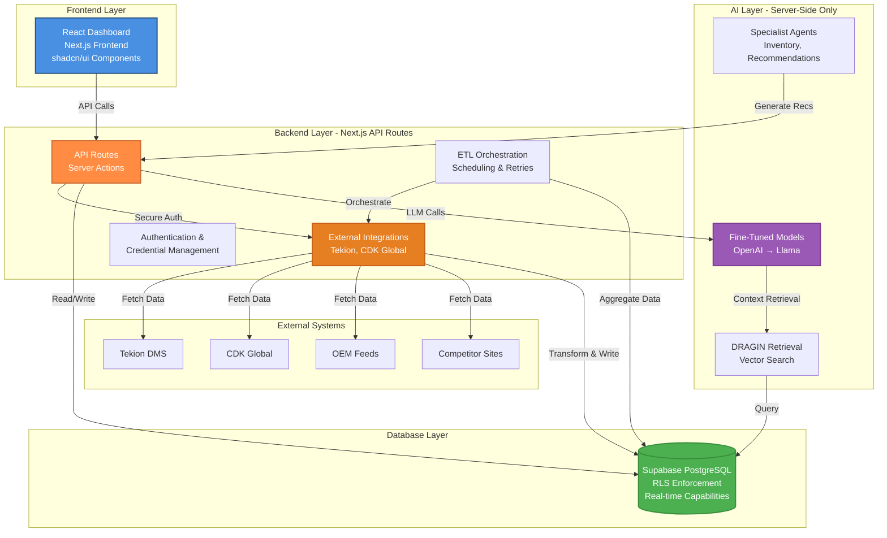

**Key Talking Points:**
- **Security First:** All external API calls happen server-side (Next.js API routes)
- **No Browser Exposure:** Credentials never leave the server
- **Single Codebase:** Frontend and backend in one Next.js project
- **Scalable Design:** Supports high-volume data pulls from Tekion/CDK
- **DRAGIN Layer:** Distributed RAG (Retrieval-Augmented Generation) over integrations - combines semantic vector search with SQL queries for intelligent data retrieval

---

## Slide 3: Why Next.js Full-Stack?

### Architecture Comparison

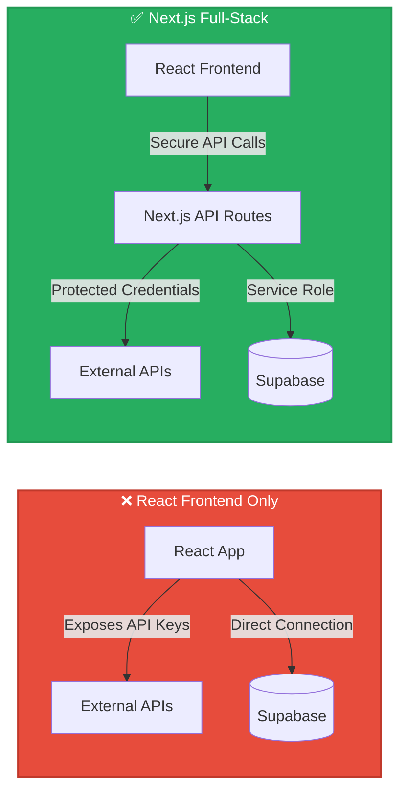

**Key Benefits:**
1. **Security:** API keys stored in environment variables (server-side only)
2. **ETL Capability:** Can handle scheduled jobs, retries, monitoring
3. **Data Transformation:** Server-side normalization before database writes
4. **Scalability:** Handles high-volume data pulls from Tekion/CDK
5. **Single Codebase:** Easier deployment and maintenance

---

## Slide 4: Development Timeline

### 3-Month Timeline Overview (Starting Nov 3, 2025)

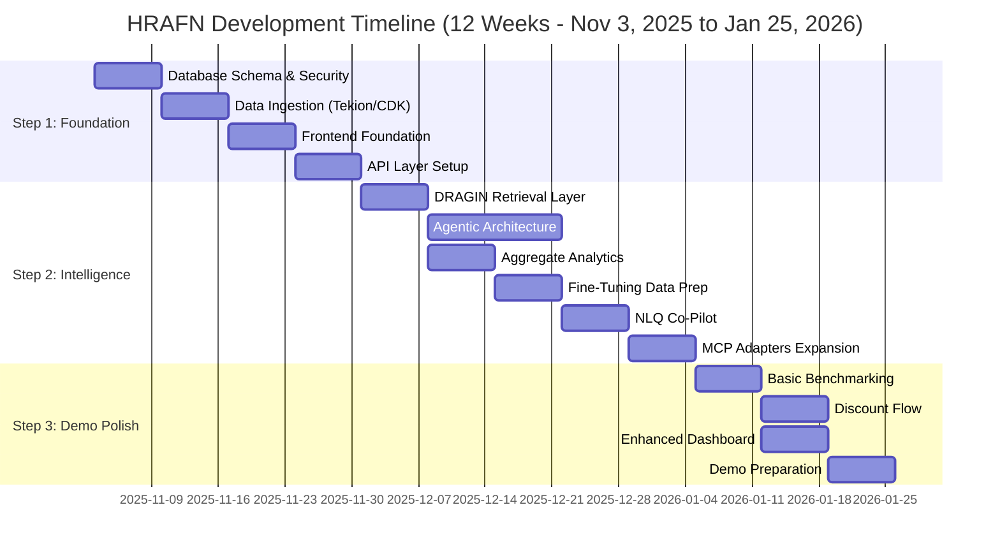

**Key Milestones:**
- **Week 4 (Nov 30, 2025):** Foundation complete - Data flowing from Tekion/CDK
- **Week 9 (Jan 4, 2026):** Intelligence layer operational - NLQ working
- **Week 12 (Jan 25, 2026):** Demo ready - Client presentation

---

## Slide 5: Step 1 - Foundation & Data Infrastructure (Weeks 1-4)

### Step 1 Architecture

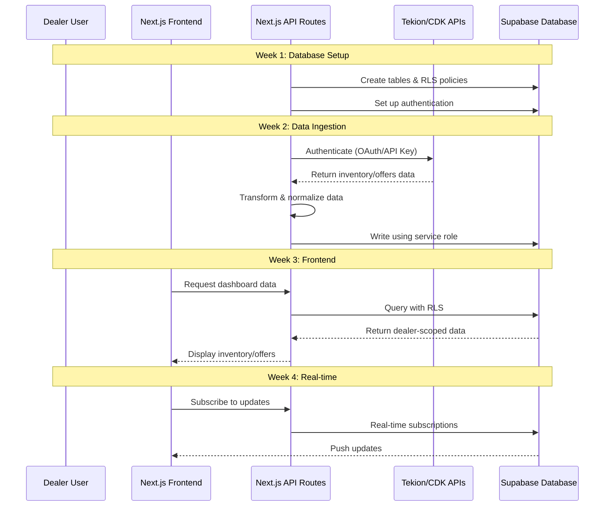

**Deliverables:**
- ✅ Secure database with RLS enforcement
- ✅ One working adapter (Tekion or CDK)
- ✅ Basic dashboard showing inventory and offers
- ✅ All data access server-side only

---

## Slide 6A: Agentic Architecture Overview

### Specialist Agents for Various User Requirements

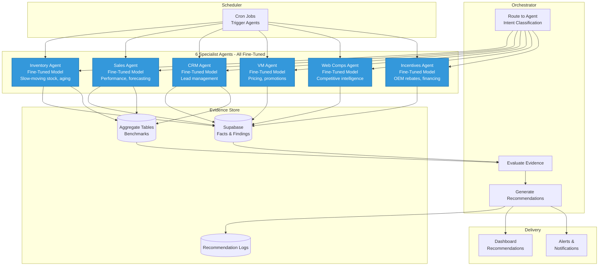

**Why Fine-Tuning is Essential:**
- Each agent handles different user requirements
- Domain-specific expertise requires fine-tuned models
- Accurate recommendations need agent understanding of business context
- 12 fine-tuned models total (6 agents + 6 NLQ pipeline)

---

## Slide 6: Step 2 - Intelligence Layer (Weeks 5-9)

### Agentic Architecture with Specialist Agents

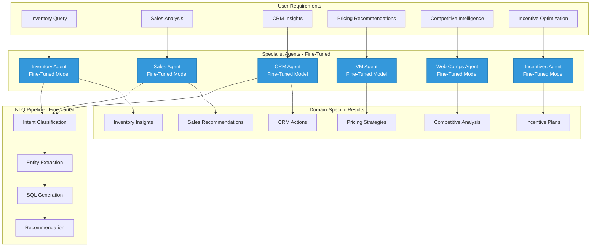

**Key Features:**
- **6 Specialist Agents:** Each fine-tuned for specific domain (Inventory, Sales, CRM, VM, Web Comps, Incentives)
- **6 NLQ Pipeline Models:** Handle natural language processing
- **Domain Expertise:** Each agent understands its specific business context
- **Handles Various Requirements:** Different agents for different user needs
- **Total: 12 Fine-Tuned Models** for complete system

---

## Slide 6B: What is DRAGIN?

### DRAGIN: Distributed RAG over Integrations

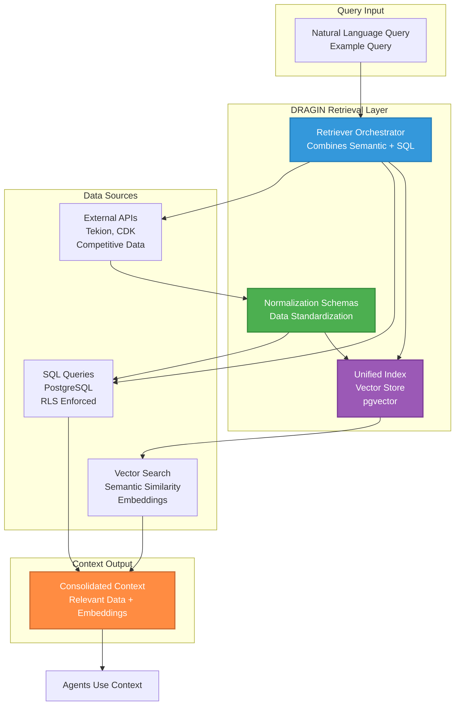

**What DRAGIN Does:**
- **Distributed RAG:** Retrieval-Augmented Generation across multiple data sources
- **Semantic + SQL:** Combines vector search (semantic similarity) with SQL queries (structured data)
- **Unified Index:** Single vector store for all dealer data (inventory, offers, etc.)
- **Normalization:** Standardizes data from different sources (Tekion, CDK, websites)
- **Context Retrieval:** Provides relevant context to agents and LLM models

**Key Components:**
1. **Retriever Orchestrator:** Routes queries to appropriate sources (SQL or vector search)
2. **Unified Index Vector Store:** Uses Supabase pgvector for semantic search
3. **Normalization Schemas:** Transforms data from different sources into unified format

**Why It's Important:**
- Agents need relevant context to generate accurate recommendations
- Combines structured data (SQL) with semantic understanding (vector search)
- Enables intelligent retrieval across all dealer data sources

---

## Slide 7: Fine-Tuning Strategy - Core Focus

### Comprehensive Fine-Tuning for Agents & NLQ Pipeline

```mermaid
graph TB
    subgraph Prep["Week 7: Data Preparation"]
        SCHEMA[Database Schema<br/>Documentation]
        DOMAIN[Domain Knowledge<br/>Business Logic]
        TRAIN_NLQ[NLQ Training Data<br/>6 models × 100-200 examples]
        TRAIN_AGENTS[Agent Training Data<br/>6 agents × 100-200 examples]
        TEST[Test Datasets<br/>20-30 examples/model]
    end
    
    subgraph NLQ["NLQ Pipeline Models"]
        FT1[Intent Classification]
        FT2[Entity Extraction]
        FT3[Query Planning]
        FT4[SQL Generation]
        FT5[Recommendation Gen]
        FT6[Response Formatting]
    end
    
    subgraph Agents["Specialist Agent Models"]
        AGT_INV[Inventory Agent<br/>Fine-Tuned]
        AGT_SALES[Sales Agent<br/>Fine-Tuned]
        AGT_VM[VM Agent<br/>Fine-Tuned]
        AGT_CRM[CRM Agent<br/>Fine-Tuned]
        AGT_WEB[Web Comps Agent<br/>Fine-Tuned]
        AGT_INC[Incentives Agent<br/>Fine-Tuned]
    end
    
    subgraph Validate["Validation"]
        VAL_NLQ[Test NLQ Pipeline<br/>End-to-End]
        VAL_AGENTS[Test Agents<br/>Domain Accuracy]
        SAFE[SQL Safety Checks<br/>RLS Validation]
    end
    
    SCHEMA --> FT1
    SCHEMA --> FT4
    SCHEMA --> AGT_INV
    DOMAIN --> AGT_INV
    DOMAIN --> AGT_SALES
    DOMAIN --> AGT_VM
    DOMAIN --> AGT_CRM
    DOMAIN --> AGT_WEB
    DOMAIN --> AGT_INC
    TRAIN_NLQ --> FT1
    TRAIN_NLQ --> FT2
    TRAIN_NLQ --> FT3
    TRAIN_NLQ --> FT4
    TRAIN_NLQ --> FT5
    TRAIN_NLQ --> FT6
    TRAIN_AGENTS --> AGT_INV
    TRAIN_AGENTS --> AGT_SALES
    TRAIN_AGENTS --> AGT_VM
    TRAIN_AGENTS --> AGT_CRM
    TRAIN_AGENTS --> AGT_WEB
    TRAIN_AGENTS --> AGT_INC
    FT1 --> VAL_NLQ
    FT2 --> VAL_NLQ
    FT3 --> VAL_NLQ
    FT4 --> VAL_NLQ
    FT5 --> VAL_NLQ
    FT6 --> VAL_NLQ
    AGT_INV --> VAL_AGENTS
    AGT_SALES --> VAL_AGENTS
    AGT_VM --> VAL_AGENTS
    AGT_CRM --> VAL_AGENTS
    AGT_WEB --> VAL_AGENTS
    AGT_INC --> VAL_AGENTS
    VAL_NLQ --> SAFE
    VAL_AGENTS --> SAFE
    
    style SCHEMA fill:#4CAF50,stroke:#388E3C,stroke-width:2px,color:#fff
    style DOMAIN fill:#9B59B6,stroke:#7D3C98,stroke-width:2px,color:#fff
    style TRAIN_NLQ fill:#3498DB,stroke:#2980B9,stroke-width:2px,color:#fff
    style TRAIN_AGENTS fill:#3498DB,stroke:#2980B9,stroke-width:2px,color:#fff
    style TEST fill:#F39C12,stroke:#D68910,stroke-width:2px,color:#fff
    style FT1 fill:#3498DB,stroke:#2980B9,stroke-width:2px,color:#fff
    style FT2 fill:#3498DB,stroke:#2980B9,stroke-width:2px,color:#fff
    style FT3 fill:#3498DB,stroke:#2980B9,stroke-width:2px,color:#fff
    style FT4 fill:#3498DB,stroke:#2980B9,stroke-width:2px,color:#fff
    style FT5 fill:#3498DB,stroke:#2980B9,stroke-width:2px,color:#fff
    style FT6 fill:#3498DB,stroke:#2980B9,stroke-width:2px,color:#fff
    style AGT_INV fill:#9B59B6,stroke:#7D3C98,stroke-width:2px,color:#fff
    style AGT_SALES fill:#9B59B6,stroke:#7D3C98,stroke-width:2px,color:#fff
    style AGT_VM fill:#9B59B6,stroke:#7D3C98,stroke-width:2px,color:#fff
    style AGT_CRM fill:#9B59B6,stroke:#7D3C98,stroke-width:2px,color:#fff
    style AGT_WEB fill:#9B59B6,stroke:#7D3C98,stroke-width:2px,color:#fff
    style AGT_INC fill:#9B59B6,stroke:#7D3C98,stroke-width:2px,color:#fff
    style VAL_NLQ fill:#27AE60,stroke:#229954,stroke-width:2px,color:#fff
    style VAL_AGENTS fill:#27AE60,stroke:#229954,stroke-width:2px,color:#fff
    style SAFE fill:#E74C3C,stroke:#C0392B,stroke-width:2px,color:#fff
```

**Why Fine-Tuning is Critical:**
- **12 Total Models:** 6 NLQ pipeline models + 6 specialist agent models
- **Domain-Specific:** Each agent needs specialized training for its domain (Inventory, Sales, CRM, etc.)
- **Accurate Recommendations:** Fine-tuned agents understand dealer business context
- **Handles Various Requirements:** Different agents handle different user needs
- **Production Ready:** Reuse all training data for Llama migration

**Key Points:**
- **Development:** Fine-tune OpenAI models (12 models total)
- **Agent Specialization:** Each agent fine-tuned for its specific domain expertise
- **Production:** Reuse training data for Llama fine-tuning (all 12 models)
- **Quality:** 100-200+ examples per model for accuracy (1,200-2,400 total examples)
- **Domain Experts Required:** Need expertise in each agent domain (Inventory, Sales, CRM, VM, Competitive Intel, Incentives)
- **Safety:** SQL validation and RLS compliance checks
- **Critical Success Factor:** Fine-tuning quality determines system accuracy and user satisfaction

---

## Slide 8: Step 3 - Demo Polish (Weeks 10-12)

### Complete Flow Diagram

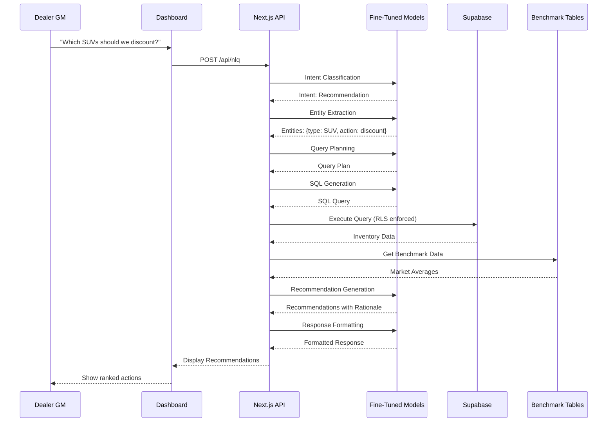

**Demo Features:**
- ✅ Natural language query → SQL → Results
- ✅ Benchmark comparisons
- ✅ Actionable recommendations
- ✅ Approval workflow (UI)

---

## Slide 9: Technology Stack

### Complete Technology Overview

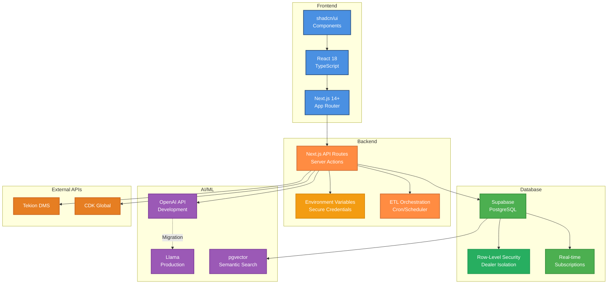

---

## Slide 10: Security Architecture

### Security Layers

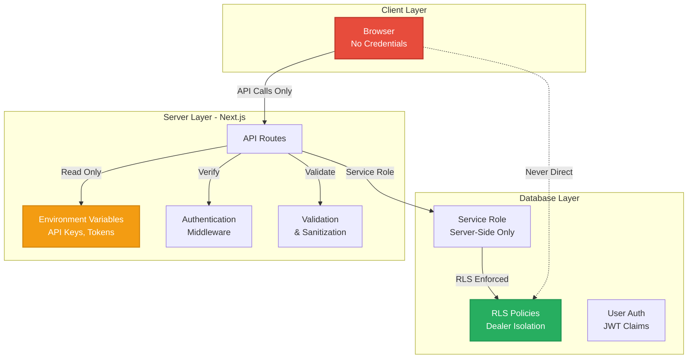

**Security Highlights:**
- ✅ Credentials never exposed to browser
- ✅ RLS ensures dealer data isolation
- ✅ All external API calls server-side
- ✅ Service role keys never in client code

---

## Slide 11: Data Flow - ETL Process

### Complete Data Ingestion Flow

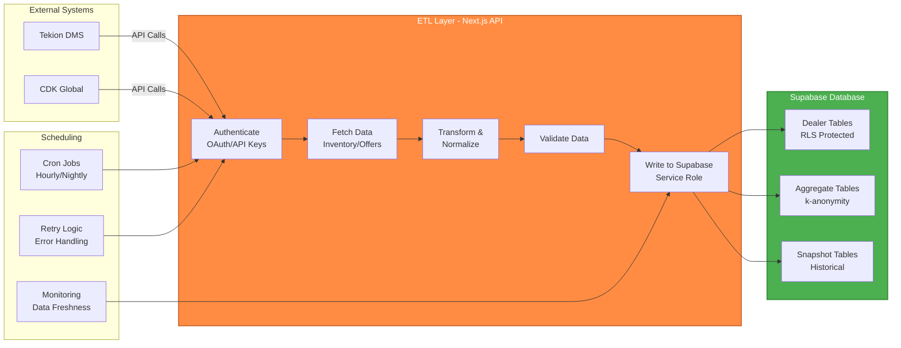

---

## Slide 12: Timeline Summary

### Key Milestones

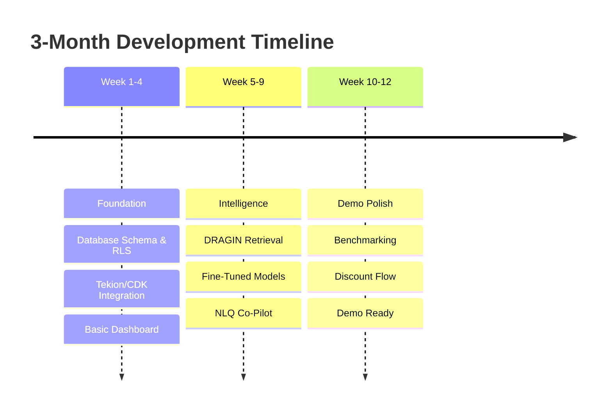

**Deliverables by Phase:**
- **Foundation:** Secure data pipeline, basic dashboard
- **Intelligence:** AI-powered recommendations, NLQ queries
- **Demo:** Complete discount flow, benchmarking, polished UI

---

## Slide 13: Budget Considerations

### Cost Breakdown

**Development Phase (3 Months):**
- OpenAI API usage (development/demo)
- OpenAI Fine-Tuning (12 models × $0.008-$0.03 per 1K tokens)
  - 6 NLQ Pipeline models
  - 6 Specialist Agent models
- Supabase hosting (database + real-time)
- Vercel hosting (Next.js deployment)
- Domain and SSL certificates

**Production Phase (Post-Demo):**
- Llama infrastructure (self-hosted or cloud)
- Llama fine-tuning (reuse training data)
- Ongoing Supabase costs
- Ongoing hosting costs
- Monitoring and logging tools

**Key Point:** Fine-tuning dataset is reusable for Llama migration, reducing long-term costs.

---

## Slide 14: Risk Mitigation

### Risk Management Strategy

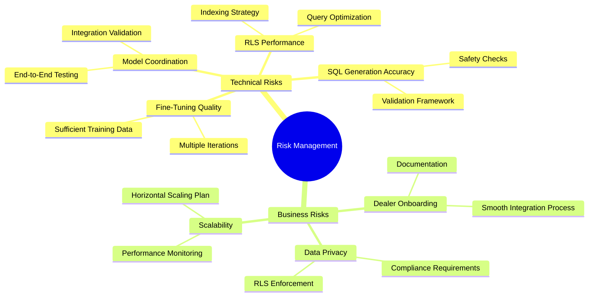

**Mitigation Strategies:**
- Early testing and validation
- Iterative fine-tuning approach
- Comprehensive error handling
- Monitoring and alerting

---

## Slide 15: Post-Demo Roadmap

### Future Enhancements

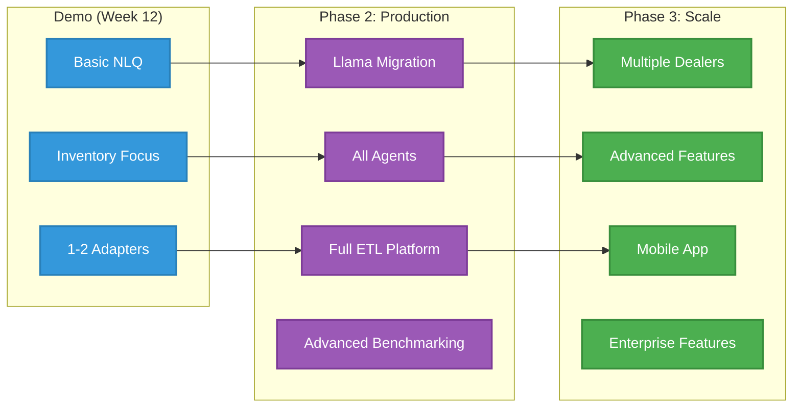

**Post-Demo Priorities:**
1. **Llama Migration** - Cost optimization
2. **Full Adapter Suite** - All dealer systems
3. **Production Hardening** - Load testing, CI/CD
4. **Advanced Features** - Multi-intent, complex queries

---

## Slide 16: Questions for Discussion

### Key Discussion Points

1. **Architecture Approval**
   - Do you approve Next.js full-stack architecture?
   - Benefits: Security, single codebase, scalability

2. **Demo Scope**
   - What are the 3-5 must-have features for demo?
   - Helps prioritize development

3. **Dealer Systems**
   - Which system first? (Tekion or CDK)
   - Focus on 1-2 for demo

4. **Demo Date**
   - Specific date for presentation?
   - Helps plan Week 12 timeline

5. **Budget**
   - OpenAI fine-tuning costs (12 models: 6 NLQ + 6 Agents)
   - Llama infrastructure planning
   - Monthly LLM usage estimates

6. **Success Metrics**
   - What would make demo successful?
   - How to measure value?

---

## Slide 17: Next Steps

### Immediate Actions

**Week 1 Requirements:**
- ✅ Supabase account setup
- ✅ Access to Tekion or CDK API (for testing)
- ✅ Design mockups/wireframes
- ✅ Database schema approval
- ✅ Architecture approval

**Parallel Work:**
- Domain expertise for fine-tuning dataset creation
- Sample dealer data (if available)
- Demo requirements clarification

---

## Slide 18: Summary

### Why This Approach Works

**Single Codebase:**
- Frontend + Backend in one Next.js project
- Easier deployment and maintenance
- Type-safe end-to-end

**Security First:**
- All credentials server-side
- No browser exposure of API keys
- RLS enforcement at database level

**Scalable Architecture:**
- Handles high-volume data pulls
- Supports multiple dealer systems
- Ready for production scaling

**AI-Native:**
- Fine-tuned models for accuracy
- Schema-aware SQL generation
- End-to-end NLQ pipeline

**3-Month Timeline:**
- MVP-first approach
- Incremental value delivery
- Demo-ready by Week 12

---
