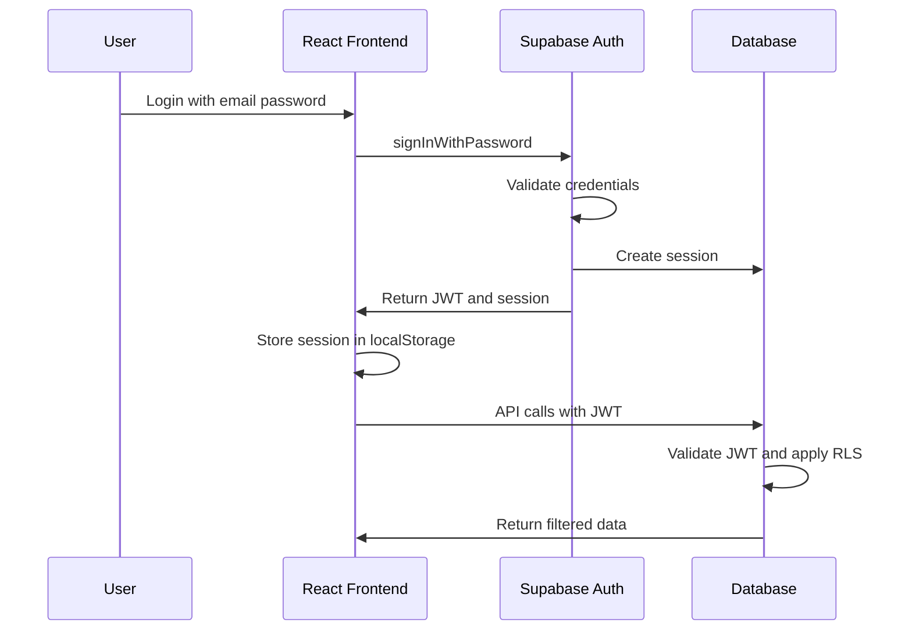
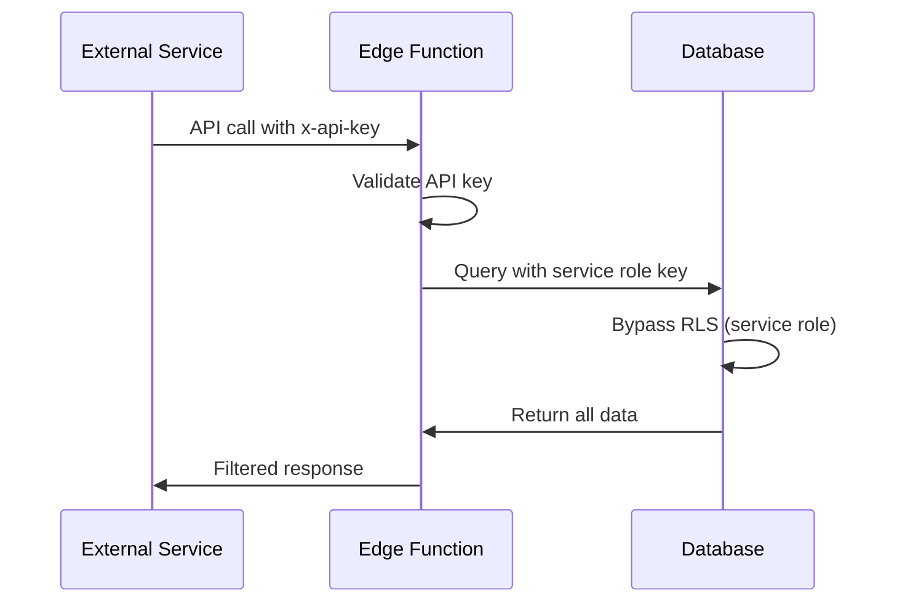

# HRAFN Security, Authentication, and Row Level Security (RLS)

**See also:** [Security Risk Model](./security_risk_model.md) | [Logging & Auditing](./logging_auditing.md) | [Data Model](./data_model.md) | [Architecture Overview](./architecture_overview.md)

This document subsumes `rls_policies.md` by including full RLS policy definitions, authentication flows, and security context. All future updates should be consolidated here.

This document provides a comprehensive overview of HRAFN's security architecture, including Row Level Security policies, authentication flows, and secrets management.

## Security Architecture Overview

HRAFN implements a multi-layered security approach:

1. **Transport Security**: TLS 1.3 for all communications
2. **Authentication**: Supabase Auth with JWT tokens
3. **Authorization**: Row Level Security (RLS) at database level
4. **API Security**: API keys and shared secrets for service authentication
5. **Frontend Security**: CSP headers and secure session management

## Authentication Flows

### User Authentication Flow



**Legend:**

- **React Frontend**: Client-side React application
- **Supabase Auth**: Supabase authentication service
- **Database**: PostgreSQL database with RLS policies

### Service Authentication Flow



**Legend:**

- **External Service**: Third-party service or internal system service
- **Edge Function**: Supabase Edge Function (serverless)
- **Database**: PostgreSQL database with RLS policies

## Row Level Security Policies

These policies are the authoritative source for dealer data isolation. See also `docs/aggregates_benchmarks_spec.md` for aggregate tables that deliberately exclude `dealer_id`.

### Dealer Integration Data Policies

#### `sales_leads` Table

```sql
-- Policy Name: dealer_read_sales_leads
-- Purpose: Dealers can only access their own sales leads
CREATE POLICY dealer_read_sales_leads ON sales_leads FOR SELECT
USING (dealer_id::text = coalesce(current_setting('request.jwt.claims', true)::jsonb->>'dealer_id',''));
```

**Plain English**: Sales leads are private to each dealer. Only users with matching `dealer_id` in their JWT can access leads.

#### `sales_activity_history` Table

```sql
-- Policy Name: dealer_read_sales_activities
-- Purpose: Dealers can only access their own sales activities
CREATE POLICY dealer_read_sales_activities ON sales_activity_history FOR SELECT
USING (dealer_id::text = coalesce(current_setting('request.jwt.claims', true)::jsonb->>'dealer_id',''));
```

**Plain English**: Sales activity history is scoped to the dealer. Users can only see activities for leads belonging to their dealership.

#### `inventory_listings` Table

```sql
-- Policy Name: dealer_read_inventory
-- Purpose: Dealers can only access their own inventory
CREATE POLICY dealer_read_inventory ON inventory_listings FOR SELECT
USING (dealer_id::text = coalesce(current_setting('request.jwt.claims', true)::jsonb->>'dealer_id',''));
```

**Plain English**: Inventory listings are private per dealer. Each dealer can only see their own vehicle inventory, not competitors' inventory.

#### `offers` Table

```sql
-- Policy Name: dealer_read_offers
-- Purpose: Dealers can only access their own offers
CREATE POLICY dealer_read_offers ON offers FOR SELECT
USING (dealer_id::text = coalesce(current_setting('request.jwt.claims', true)::jsonb->>'dealer_id',''));
```

**Plain English**: Promotional offers are dealer-specific. Users can only view offers created by their own dealership.

#### `recommendation_logs` Table

```sql
-- Policy Name: dealer_read_recommendation_logs
-- Purpose: Dealers can only access their own recommendation and execution logs
CREATE POLICY dealer_read_recommendation_logs ON recommendation_logs FOR SELECT
USING (dealer_id::text = coalesce(current_setting('request.jwt.claims', true)::jsonb->>'dealer_id',''));
```

**Plain English**: Recommendation logs are scoped to each dealer. Users can only see recommendation and execution data related to their dealership.

### Tables Without RLS (Public/System Data)

The following tables do **not** have RLS policies because they contain:

- **Reference data**: `dealers`
- **System operational data**: `scrape_jobs`, `page_snapshots`, `change_events`
- **Aggregated intelligence data**: `aggregate_inventory_metrics`, `aggregate_offer_performance`

Note: these tables are still access-controlled via database roles and API gateway, and aggregate tables must maintain k-anonymity and SELECT-only access.

## JWT Token Structure

### Standard Claims

```json
{
  "aud": "authenticated",
  "exp": 1692123456,
  "iat": 1692037056,
  "iss": "https://project.supabase.co/auth/v1",
  "sub": "user-uuid-here",
  "email": "user@dealer.com",
  "phone": "",
  "app_metadata": {
    "provider": "email",
    "providers": ["email"]
  },
  "user_metadata": {},
  "role": "authenticated"
}
```

### Custom Claims for RLS

```json
{
  "dealer_id": "dealer-uuid-here",
  "role": "dealer_user"
}
```

**Implementation**: Custom claims are set via Supabase Auth hooks or Edge Functions during user registration/login.

## Authentication Security Features

### Password Policy

```sql
-- Implemented via Edge Function: validate-password
-- Requirements:
-- - Minimum 8 characters
-- - At least 1 uppercase letter
-- - At least 1 lowercase letter
-- - At least 1 number
-- - At least 1 special character (!@#$%^&*)
```

### Session Management

- **Default**: sessionStorage (no persistence across browser restarts)
- **Remember Me**: localStorage (persists across browser restarts)
- **Idle Timeout**: Configurable via `VITE_SESSION_IDLE_MINUTES` (default: 30 minutes)
- **Hard Logout**: Clears all auth tokens and redirects to login

### Email Verification

```sql
-- Enforced via auth.users table
-- Users must verify email before accessing protected routes
-- Unverified users see verification gate component
```

### Rate Limiting

- **Client-side**: Exponential backoff after failed login attempts
- **Account Lockout**: 3 failed attempts triggers password reset prompt
- **Magic Link**: Rate limited to prevent abuse

## API Security

### Dealer Integration

```typescript
// API Key Authentication
const FORTELLIS_API_KEY = process.env.FORTELLIS_API_KEY;

// Validation in Edge Functions
if (request.headers.get("x-api-key") !== FORTELLIS_API_KEY) {
  return new Response("Unauthorized", { status: 401 });
}
```

### Competitive Intelligence Ingestion

```typescript
// Shared Secret Authentication
const SERVICE_INGEST_SECRET = process.env.SERVICE_INGEST_SECRET;

// Signature validation
const signature = request.headers.get("x-ingest-signature");
if (signature !== SERVICE_INGEST_SECRET) {
  return new Response("Forbidden", { status: 403 });
}
```

### CORS Configuration

```typescript
// Environment-based origin allowlist
const ALLOWED_ORIGINS = process.env.ALLOWED_ORIGINS?.split(",") || [
  "https://dealer.hrafn.ai",
  "https://next.hrafn.ai",
];

// Development environment detection
if (process.env.VITE_HRAFN_ENV === "development") {
  ALLOWED_ORIGINS.push("http://localhost:8080");
}
```

## Secrets Management

### Environment Variables Classification

#### **Public** (VITE\_ prefix - exposed to frontend)

```bash
VITE_SUPABASE_URL=https://project.supabase.co
VITE_SUPABASE_ANON_KEY=eyJ0eXAiOiJKV1QiLCJhbGciOiJIUzI1NiJ9...
VITE_PUBLIC_APP_URL=https://next.hrafn.ai
VITE_POSTHOG_KEY=phc_...
VITE_SESSION_IDLE_MINUTES=30
VITE_HRAFN_ENV=production
```

#### **Private** (Server-side only)

```bash
SUPABASE_SERVICE_ROLE_KEY=eyJ0eXAiOiJKV1QiLCJhbGciOiJIUzI1NiJ9...
FORTELLIS_API_KEY=your-fortellis-api-key
FORTELLIS_API_SECRET=your-fortellis-secret
SERVICE_INGEST_SECRET=your-ci-ingest-secret
OPENAI_API_KEY=sk-...
FIREWORKS_API_KEY=fw-...
APP_ACCESS_PASSWORD=your-password
```

### Secret Rotation Strategy

1. **API Keys**: Rotate quarterly or on security incidents
2. **JWT Secrets**: Handled automatically by Supabase
3. **Service Secrets**: Generate cryptographically secure random strings
4. **Database Passwords**: Managed by Supabase, rotate annually

## Security Headers

### Content Security Policy

```http
Content-Security-Policy: default-src 'self';
  img-src 'self' data: https:;
  script-src 'self' 'unsafe-inline';
  style-src 'self' 'unsafe-inline';
  connect-src 'self' https://*.supabase.co https://*.posthog.com https://*.vercel.app;
```

### Additional Security Headers

```http
X-Frame-Options: DENY
X-Content-Type-Options: nosniff
Referrer-Policy: strict-origin-when-cross-origin
Permissions-Policy: camera=(), microphone=(), geolocation=()
```

## Database Security

### Connection Security

- **Encryption**: All connections use TLS 1.3
- **Connection Pooling**: Supabase connection pooler prevents connection exhaustion
- **IP Allowlisting**: Production database restricts connections to known IPs

### Service Role Usage

```typescript
// Service role bypasses RLS - use carefully
const supabaseService = createClient(
  process.env.SUPABASE_URL!,
  process.env.SUPABASE_SERVICE_ROLE_KEY!,
);

// Only for:
// 1. Data ingestion from trusted sources
// 2. System maintenance operations
// 3. Cross-dealer analytics (aggregated data)
```

### Anonymous Key Usage

```typescript
// Anonymous key respects RLS - safe for frontend
const supabaseAnon = createClient(
  process.env.VITE_SUPABASE_URL!,
  process.env.VITE_SUPABASE_ANON_KEY!,
);

// Used for:
// 1. User authentication
// 2. Dealer-scoped data queries
// 3. Public reference data access
```

## Security Monitoring

### Authentication Events

- **Login Success/Failure**: Tracked via PostHog
- **Password Reset Requests**: Logged for abuse detection
- **Session Timeouts**: Monitored for UX optimization
- **Account Lockouts**: Alerts for potential attacks

### Database Access Patterns

- **RLS Policy Violations**: Logged automatically by PostgreSQL
- **Service Role Usage**: Monitored for unexpected access patterns
- **Query Performance**: Slow queries may indicate security issues

### API Security Monitoring

- **Invalid API Keys**: Rate of authentication failures
- **CORS Violations**: Blocked cross-origin requests
- **Unusual Traffic Patterns**: Potential DDoS or scraping attempts

## Compliance & Audit

### Data Privacy

- **PII Handling**: Customer data encrypted at rest and in transit
- **Data Retention**: Automated cleanup of old snapshots and logs
- **Right to Deletion**: User account deletion removes all associated data
- **Aggregate-Safe Analytics**: All analytics are performed on aggregated data to protect dealer privacy
- **Dealer Isolation**: Data access strictly isolated by dealer via RLS policies
- **Recommendation Audit Trails**: All recommendation executions are logged for compliance and traceability

### Audit Trail

- **Database Changes**: All modifications logged via triggers
- **Authentication Events**: Complete login/logout history
- **API Access**: Edge Function logs retain request/response data
- **Configuration Changes**: Environment variable changes tracked

## Security Best Practices

### Development

- **No Hardcoded Secrets**: All secrets via environment variables
- **Least Privilege**: RLS policies grant minimum necessary access
- **Input Validation**: All user inputs validated and sanitized
- **Error Handling**: No sensitive information in error messages

### Production

- **Regular Updates**: Dependencies updated monthly
- **Security Scanning**: Automated vulnerability scanning
- **Backup Encryption**: Database backups encrypted at rest
- **Incident Response**: Documented procedures for security incidents
- **Aggregate-Safe Analytics**: Ensure all analytics use aggregated data to prevent dealer data leakage
- **Dealer Isolation Enforcement**: Continuous monitoring to ensure strict dealer data separation
- **Recommendation Audit Trails**: Maintain detailed logs of recommendation executions for audit and compliance

## Known Security Limitations

### Current Gaps

1. **No 2FA/MFA**: Single-factor authentication only
2. **Basic Rate Limiting**: Client-side only, no server-side rate limiting
3. **No Account Lockout**: Failed attempts don't lock accounts permanently
4. **Limited Session Controls**: No concurrent session limits

### Planned Improvements

1. **2FA Implementation**: TOTP-based two-factor authentication
2. **Server-side Rate Limiting**: Edge Function-based rate limiting
3. **Advanced Session Management**: Device tracking and session limits
4. **Security Audit Logging**: Enhanced audit trail with alerting

## Change Log

- v0.1: Initial draft with comprehensive RLS policies, authentication flows, and security architecture
